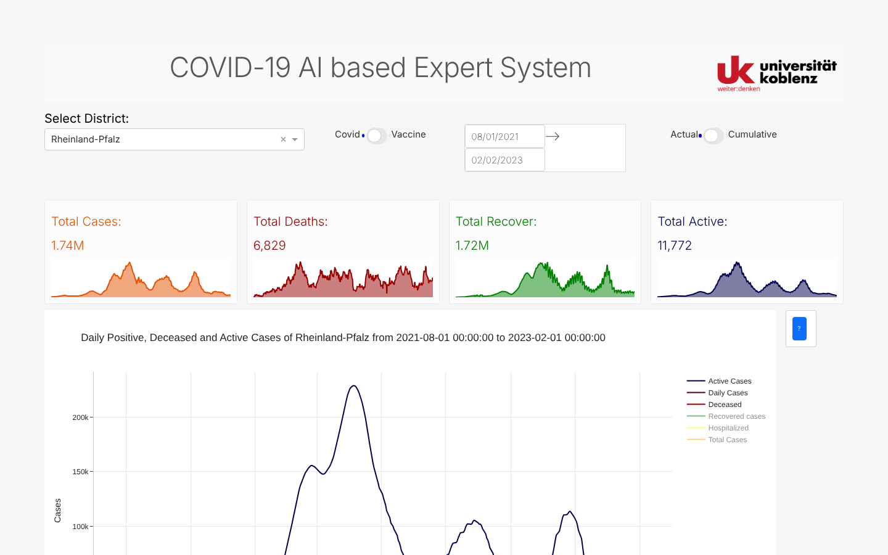
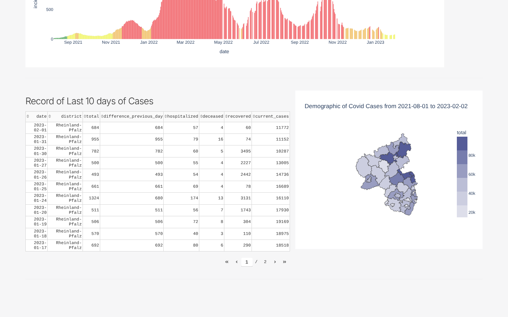
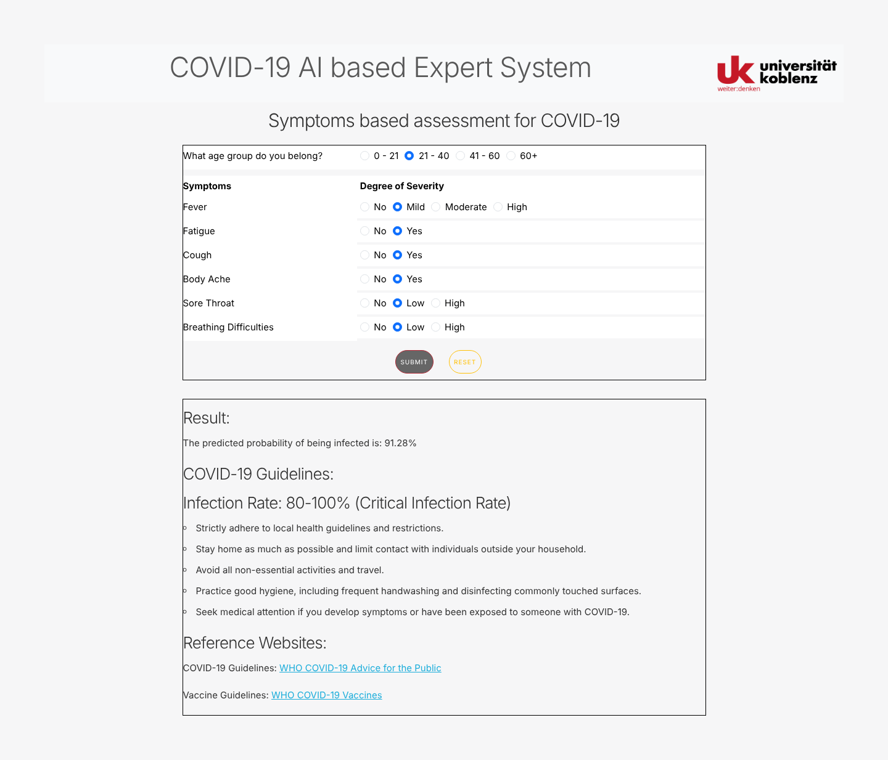

# COVID-19 Dashboard and Symptom Risk Assessment

An interactive web app, built with **Python, Plotly Dash and scikit-learn**, that tracks COVID-19 cases and vaccinations across the districts of **Rhineland-Palatinate, Germany** and estimates a person's infection risk from their symptoms.

Built as a research project at the University of Koblenz.



## Features

**Dashboard**
- KPI cards with trend lines for total cases, deaths, recoveries and active cases
- Switch between **COVID cases** and **vaccination** data, and between **daily** and **cumulative** views
- Filter by district and date range
- Daily cases, deaths and active cases over time
- 7-day incidence chart coloured by severity (mild, moderate, severe, very severe)
- District-level choropleth map
- Table of the last 10 days of case records



**Symptom-based risk assessment**
- The user selects an age group and the severity of six symptoms
- Three models are trained on a symptoms dataset: **Logistic Regression, Random Forest and Gradient Boosting**
- Their predicted probabilities are averaged into a single infection-risk percentage
- WHO-based guidance is shown for the resulting risk band



> This is an academic project. The risk score is not medical advice.

## Tech stack

| Area | Tools |
| --- | --- |
| Web app | Dash, Dash Bootstrap Components, Dash DAQ |
| Charts and maps | Plotly (line, bar, choropleth with GeoJSON) |
| Data processing | pandas, NumPy |
| Machine learning | scikit-learn |

## Run it locally

Requires Python 3.10 or newer.

```bash
git clone https://github.com/rjodhani-data/covid19-dashboard.git
cd covid19-dashboard

python -m venv venv
# Windows:
venv\Scripts\activate
# macOS / Linux:
source venv/bin/activate

pip install -r requirements.txt
python main.py
```

Open **http://127.0.0.1:8050** in your browser. Run the commands from the project folder, because the app loads its data from the `files/` folder.

## Project structure

```
├── main.py                  # Entry point: python main.py
├── app.py                   # Dash app and navigation (multi-page)
├── pages/
│   ├── home.py              # Landing page
│   ├── dashboard.py         # Charts, KPIs, map and table
│   ├── assessment.py        # Symptom form and ML models
│   ├── support_functions.py # Data preparation helpers
│   └── layout_configs.py    # Shared chart styling
├── files/                   # Case, vaccination, symptoms and GeoJSON data
├── assets/                  # CSS and images
└── screenshots/
```

## Data

- COVID-19 case reports and vaccination data for Rhineland-Palatinate districts
- District boundaries (GeoJSON) for the map
- A symptoms dataset used to train the assessment models

## Author

**Rajvi Jodhani** · [LinkedIn](https://www.linkedin.com/in/rajvi-jodhani)
